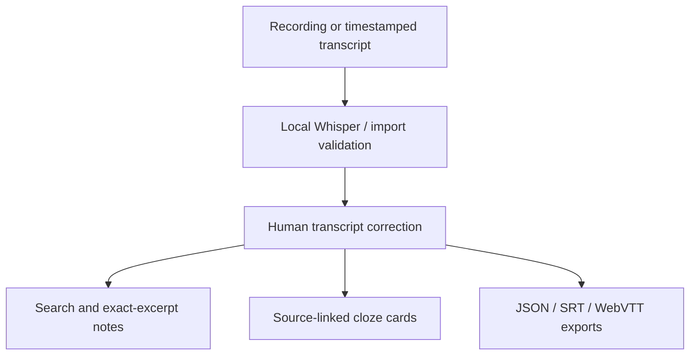

# LectureLens — Local Speech-to-Study Workbench

A local application that turns a recording into a reviewable timestamped transcript, searchable moments, extractive notes, captions and source-linked fill-in-the-blank cards.

## The problem
Students spend time scrubbing through recordings to locate an explanation, correct a misunderstood term or prepare study material. LectureLens links study excerpts and card answers to exact transcript segments and recording times, while keeping corrections under the student's control.

## Run on a Mac
Python 3.11 or 3.12. Move `lecturelens` to Desktop:
```bash
cd ~/Desktop/lecturelens
bash run.sh
```
Open http://localhost:8507 . No API key or paid service. The included authored transcript demo works immediately. First audio transcription downloads the selected Whisper model; tiny.en is the smallest default. No separate system ffmpeg installation is needed for the tested PyAV wheel setup.

## First use
1. Explore the clearly labeled authored transcript demo.
2. Search `precision recall` or `overfitting` and inspect source timestamps.
3. Open Study notes and Practice cards.
4. Upload an English WAV/MP3/M4A/FLAC/OGG/MP4 recording you have permission to process, then click Transcribe recording.
5. Review/edit recognized words against the audio, mark reviewed segments and save corrections.
6. Export JSON, SRT, WebVTT, Markdown notes or CSV cards.

Limits: up to 100 MB audio and 90 decoded minutes. Transcripts: JSON/SRT/VTT up to 5 MB, up to 5,000 segments. Processing long recordings may take substantial CPU time. The app is single-user and local; it is not a hosted privacy platform.

## Implemented
- Actual local Whisper speech recognition via faster-whisper, CPU int8.
- Segment timestamps and audio playback from retrieved moments.
- Transcript import and correction with interval validation.
- Lexical TF-IDF search over transcript segments.
- Exact-excerpt notes using centrality and diversity ranking.
- Cloze cards based on phrases literally present in the source segment.
- Timestamped caption and study-packet exports.
- Tests, Mac launcher and GitHub CI.

This version does not include speaker diarization, slides/OCR, translation, unrestricted question answering or generative conceptual explanations. Notes are extractive, not LLM summaries. Search is lexical, not semantic embedding search. Cards are fill-in-the-blank exercises, not independently reviewed exam questions.

## Architecture


## Source grounding and limits
Every note and card retains a source segment ID, start/end time and exact transcript quote. This proves the excerpt belongs to the transcript, not that the transcription or lecturer is correct. ASR can omit or hallucinate words. Low log-probability highlighting is a heuristic, not a validated error detector. Review important claims against the recording.

Demo timestamps are illustrative and authored; they are not recognized audio. The demo label stays visible. A separate actual 11-second speech smoke test is recorded in reports/asr_smoke.json. It does not establish accuracy on lectures, accents, background noise, technical vocabulary or long recordings.

## Corrected transcripts
Edits must preserve unique segment IDs, positive finite intervals, ordered non-overlapping timestamps and nonempty text. Saving corrections rebuilds study material from the current text. Exports contain your current corrections. No background cloud call or automatic permanent transcript storage is added; temporary inference files are removed after processing. Audio bytes and current transcript remain in the local Streamlit session until cleared/closed; do not expose the app publicly with private recordings.

## Reproduce checks
```bash
python -m unittest discover -s tests -v
```
`requirements-tested.txt` lists tested direct package versions. PyAV is pinned to a tested compatible range because a newer PyAV release removed an argument used by this faster-whisper version. These are direct pins, not a transitive lockfile. Models are downloaded separately; network access is needed on first use. No model was trained from scratch.

## Portfolio and sources
See PORTFOLIO_GUIDE.md for presentation and GitHub instructions, MODEL_CARD.md for boundaries and SOURCES.md for model/test audio attribution. The implementation was created with AI assistance; describe your own contributions and dates accurately.
